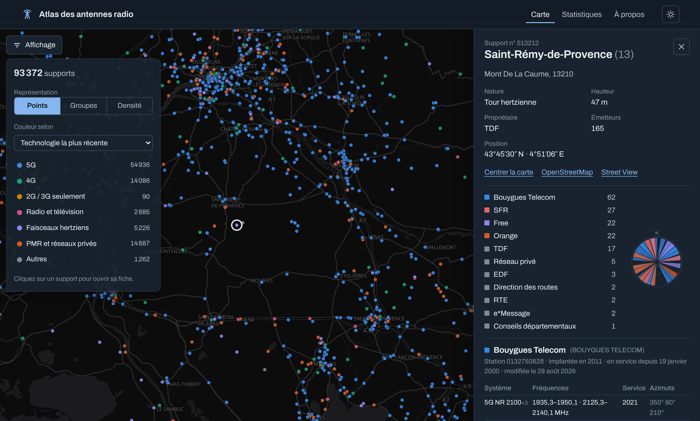

# Atlas des antennes radio en France

Site statique pour explorer les **installations radioélectriques de plus de 5 W** déclarées à l'ANFR en
France métropolitaine : supports (pylônes, toits, châteaux d'eau…), exploitants, technologies
(GSM, UMTS, LTE, 5G NR, FM, TNT, PMR, faisceaux hertziens…), bandes de fréquences et dates de mise en service.

Les données sont régénérées chaque mois par une GitHub Action, puis le site est publié sur GitHub Pages.




> Le jeu ANFR exclut les installations de l'Aviation civile, de la Défense et du ministère de l'Intérieur.

## État d'avancement

| Étape | Contenu | État |
|---|---|---|
| 1 | Pipeline, statistiques, page Statistiques, déploiement | fait |
| 2 | Carte des supports et fiche support | fait |
| 3 | Filtres combinables | fait |
| 4 | Recherche « autour de moi » | à faire |
| 5 | Frise du déploiement (avec les archives depuis 2018) | à faire |
| 6 | Spectre d'une zone | à faire |
| 7 | Finitions, page À propos complète | en partie (page À propos déjà en ligne) |

## Démarrage rapide

Prérequis : Python 3.11+ et Node.js 20+.

```bash
python -m venv .venv && source .venv/bin/activate
pip install -r requirements.txt
```

```bash
python -m pipeline build
```

```bash
cd site && npm install && npm run dev
```

`python -m pipeline build` télécharge la dernière extraction ANFR (~66 Mo) et le référentiel des communes,
nettoie les données et écrit les fichiers du site dans `site/public/data/`. Il faut compter environ
une minute une fois les fichiers téléchargés.

### Commandes du pipeline

| Commande | Effet |
|---|---|
| `python -m pipeline build` | dernière extraction publiée |
| `python -m pipeline build --extraction 20260831` | une extraction précise (AAAAMMJJ) |
| `python -m pipeline build --zip data.zip ref.zip --date 2026-09-30` | archives déjà téléchargées, sans réseau ANFR |
| `python -m pipeline build --refresh-geo` | re-télécharge le référentiel communes |
| `python -m pytest tests` | tests du nettoyage sur un mini-jeu synthétique |
| `python scripts/explore.py` | régénère le rapport brut `docs/data-exploration-annexe.md` |

### Commandes du site (`site/`)

| Commande | Effet |
|---|---|
| `npm run dev` | serveur de développement |
| `npm run check` | vérification des types (svelte-check) |
| `npm run build` | build statique dans `site/dist/` |

## Architecture

```
pipeline/                 Python + DuckDB
  fetch.py                découverte des extractions via l'API data.gouv.fr, téléchargement avec reprise
  load.py                 extraction des zip, détection d'encodage (UTF-8 / Windows-1252), tables brutes
  communes.py             référentiel geo.api.gouv.fr (population, superficie, arrondissements)
  clean.py                nettoyage : supports dédoublonnés, DMS -> WGS84, unités de fréquence,
                          dates, rattachement communal, indicateurs de qualité
  stats.py                stats.json
  export.py               supports.json (index de la carte), detail/<dep>.json (fiches), référentiels
  geo.py                  contours des départements (Etalab, repli france-geojson)
  refs/systemes.csv       système ANFR -> famille, génération, bande, fenêtre de fréquences attendue
  refs/exploitants.csv    libellé ANFR -> groupe, catégorie
site/                     Vite + Svelte 5 + TypeScript, sans backend
  src/pages/              Carte, Statistiques, À propos
  src/lib/map/            carte MapLibre (points, groupes, densité) et fiche support
  src/lib/supports.ts     décodage de l'index des supports en tableaux typés
  src/lib/charts/         graphiques SVG faits main (spectre, barres, colonnes, rose des azimuts)
  src/lib/ui/             tableau triable, sections, puces de filtre, infobulle
docs/                     exploration des données (synthèse + annexe générée)
tests/                    tests pytest du nettoyage
.github/workflows/        ci.yml (tests + build), deploy.yml (données mensuelles + Pages)
```

### Fichiers produits (`site/public/data/`)

| Fichier | Contenu | Taille (brut / gzip) |
|---|---|---|
| `stats.json` | statistiques nationales précalculées | 0,2 Mo / 30 Ko |
| `supports.json` | index en colonnes des ~93 000 supports : position, hauteur, nature, propriétaire, commune, masques de bits opérateurs / générations / familles, dates | 5 Mo / 1,5 Mo |
| `services.json` + `services.bin.gz` | une ligne par support × exploitant × système (880 000) : mois de 1re mise en service, jeu de bandes (dictionnaire de 4 170 jeux) ; colonnes binaires décompressées dans le navigateur (`DecompressionStream`) | 0,3 Mo + 1,5 Mo |
| `detail/<dep>.json` | fiches complètes d'un département : stations, émetteurs (système, bandes, date), antennes (type, azimut, hauteur) ; chargées au clic | 0,3 à 5,5 Mo / 40 à 700 Ko |
| `departements.geojson` | contours simplifiés | 0,2 Mo / 70 Ko |
| `communes.json`, `departements.json` | référentiels (recherche, classements) | 2 Mo / 0,7 Mo |

Dans `supports.json`, les colonnes `id`, `lat`, `lon` et `com` sont encodées en différences (tri par commune),
ce qui réduit d'environ 20 % la taille compressée. Les émetteurs identiques d'une station (même système, même
date, mêmes bandes) sont fusionnés dans les fiches : un site trisectoriel tient en une ligne par système.

### Choix techniques

- **DuckDB** lit directement les CSV ANFR à virgule décimale et fait les jointures sur 2,4 M émetteurs
  et 4,7 M bandes en quelques secondes, avec peu de mémoire.
- **Filtrage côté navigateur plutôt que tuiles vectorielles.** Avec ~93 000 supports en métropole, un index
  compact tient en mémoire et permet des filtres combinés exacts (opérateur × système × bande × date),
  ce que des PMTiles ne permettent pas sur des attributs à plusieurs valeurs. Le détail d'un support
  (émetteurs, bandes, antennes) sera découpé par département et chargé à la demande.
- **Aucune donnée générée n'est commitée.** Les archives brutes (`data/raw/`), le cache et `site/public/data/`
  sont ignorés par git ; la CI les reconstruit et publie le résultat comme artefact GitHub Pages.
- **Svelte 5** pour un front léger et réactif. Les graphiques sont écrits à la main en SVG
  (~34 Ko gzip de JavaScript hors carte). MapLibre (~280 Ko gzip) n'est chargé qu'à l'ouverture de la carte.
- **Fond de carte OpenFreeMap** (tuiles vectorielles OpenStreetMap, sans clé d'API), styles *dark* et *positron*
  selon le thème. S'il est inaccessible, la carte se rabat sur les contours des départements.
- **Filtres exacts côté client.** Un support est retenu si au moins une de ses lignes de service satisfait
  *tous* les critères de service à la fois (exploitant, génération, famille, système, bande, date) : « Free + 5G »
  n'attrape pas un pylône où Free n'a que de la 4G et Orange de la 5G. Les critères du support (territoire,
  nature, hauteur) sont testés sur l'index. Au sein d'un critère, les valeurs se combinent par OU ; entre
  critères, par ET. Le calcul parcourt 880 000 lignes en quelques dizaines de millisecondes.
- **URL partageables** : `#/carte?s=<id du support>&c=<lat>,<lon>&z=<zoom>&m=densite&col=hauteur`, et les filtres :
  `op=Free|Orange&gen=5G&f=3400-3800&y=2025-2026&dep=35&com=35238&nat=…&h=30-350`.

## Déploiement

1. Dans le dépôt GitHub : *Settings → Pages → Build and deployment → Source : **GitHub Actions***.
2. Le workflow `deploy.yml` s'exécute à chaque push sur `main`, les 9 et 16 de chaque mois
   (après la publication ANFR) et à la demande (onglet *Actions*, avec une extraction au choix).

## Sources et licence

- ANFR, [Données sur les installations radioélectriques de plus de 5 watts](https://www.data.gouv.fr/fr/datasets/donnees-sur-les-installations-radioelectriques-de-plus-de-5-watts-1/),
  Licence Ouverte 2.0.
- [geo.api.gouv.fr](https://geo.api.gouv.fr/) (populations et superficies communales).
- Contours des départements : [Etalab / IGN](https://github.com/etalab/contours-administratifs), ou à défaut
  [france-geojson](https://github.com/gregoiredavid/france-geojson) (dérivé IGN).
- Fond de carte : [OpenFreeMap](https://openfreemap.org/), © [OpenMapTiles](https://www.openmaptiles.org/),
  données © [contributeurs OpenStreetMap](https://www.openstreetmap.org/copyright).

Les limites et traitements des données sont décrits dans [`docs/data-exploration.md`](docs/data-exploration.md)
et sur la page *À propos* du site.
